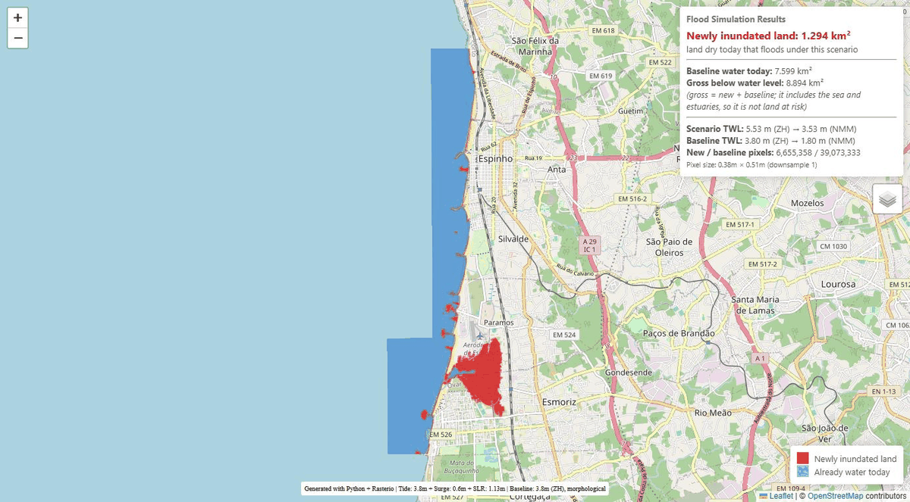

# Coastal Flood Simulation System

[](https://opensource.org/licenses/MIT)
[](https://julialang.org/)
[](https://www.python.org/)
[](https://github.com/randsley/coastal-flood-modeling/stargazers)
[](https://github.com/randsley/coastal-flood-modeling/issues)
[](https://doi.org/10.5281/zenodo.18186744)

High-resolution coastal flood modeling for Portuguese coastal zones using 50cm Digital Elevation Models (DEMs) from DGT (Direção-Geral do Território).

---

## Table of Contents
- [Overview](#overview)
- [Key Features](#key-features)
- [Parity Between Python and Julia](#parity-between-python-and-julia)
- [Quick Start](#quick-start)
- [Installation](#installation)
- [Data Setup](#data-setup)
- [Usage](#usage)
- [Vertical Datum & Area Calculation](#vertical-datum--area-calculation)
- [Algorithm Details](#algorithm-details)
- [Baseline water, and what "flooded area" means](#baseline-water-and-what-flooded-area-means)
- [Output Files](#output-files)
- [Example Results](#example-results)
- [Main Scripts](#main-scripts)
- [Performance Tips](#performance-tips)
- [Troubleshooting](#troubleshooting)
- [Tiling Guide](#tiling-guide)
- [Citation](#citation)
- [License](#license)
- [Contact](#contact)
- [Acknowledgments](#acknowledgments)
- [Contributing](#contributing)

## Overview

This system implements **connected morphological flooding algorithms** to simulate coastal inundation under various sea level scenarios. Unlike simple "bathtub" models, it uses morphological reconstruction to ensure only **hydrologically-connected** areas are identified as flooded.

The headline figure is **newly inundated land**: the scenario extent minus the water that is already there today. The DGT DEM covers the sea surface as well as the land, so an unsubtracted extent counts the Atlantic and the Ria de Aveiro as "flooded" and overstates the land at risk by roughly a factor of seven.

### Key Features

- **High Resolution**: 50cm DEM resolution for detailed flood mapping
- **Hydrologically Connected**: Uses morphological erosion to prevent isolated depressions from incorrectly appearing flooded
- **Net vs. gross**: a present-day baseline water mask separates new inundation from existing water, and both figures are reported
- **Large Area Support**: Tiled processing for regions >150 km coastline, with each pixel counted exactly once
- **Multiple Outputs**: Classified GeoTIFF for GIS analysis, interactive HTML maps for visualization
- **Dual Implementation**: Python and Julia versions, reading the same pixels through the same GDAL calls
- **Tested**: synthetic-DEM test suites in both languages (`test_flood_simulation.py`, `test_flood_simulation.jl`)

---

## Parity Between Python and Julia

Both Python and Julia implementations now have full feature parity:
- Identical flood algorithms, baseline definition, tiling and outputs (GeoTIFF, HTML maps, statistics)
- Both read the DEM through the same windowed, decimated GDAL call, so they see exactly the same pixels; the two differ only in array layout (Python is row-major `(lat, lon)`, Julia is `(lon, lat)`)
- Minor differences: HTML map rendering (Pillow for Python, FileIO/ImageIO for Julia)
- Choose either language based on your workflow or performance needs

## Quick Start

### Small Areas (< 50 km coastline)

**Julia (Recommended):**
```bash
julia simul_flood.jl
```

**Python:**
```bash
python Simul_corrected.py
```

### Large Areas (> 50 km coastline)

For large regions like Caminha to Aveiro (~150 km):

```bash
julia simul_flood_tiled.jl     # writes tiles_output_julia/
python Simul_tiled.py          # writes tiles_output/
```

This automatically:
- Divides the region into manageable tiles (~16.5 km cores)
- Runs one coarse whole-region connectivity pass, so tile borders only admit water where water really reaches
- Processes each tile with 500 m of overlap for flood connectivity, then crops it to its non-overlapping core
- Generates individual GeoTIFFs and HTML maps per tile
- Reports regional totals with every pixel counted once
- Creates a merged VRT for QGIS viewing

Both run at `downsample=4` (~2 m) by default, because the 50 cm VRT over this region is 1.8 × 10¹⁰ pixels.

## Installation

### Prerequisites

**Julia Dependencies:**
```julia
using Pkg
Pkg.add(["Rasters", "ArchGDAL", "ImageMorphology", "Statistics"])
Pkg.add(["FileIO", "ImageIO", "ColorTypes"])  # For HTML maps
Pkg.add("GLMakie")  # Optional: for interactive plotting
```

**Python Dependencies:**
```bash
pip install rasterio numpy scikit-image Pillow
```

`Pillow` is optional (without it, HTML maps fall back to a rectangle overlay). The GDAL Python bindings (`osgeo`) are optional too, and only speed up VRT merging — `merge_tiles_to_vrt` writes the mosaic VRT itself when they are missing. A GeoPackage or shapefile water-mask polygon additionally needs one of `geopandas`, `fiona` or `osgeo`; GeoJSON needs nothing extra.

### Data Setup

**Note**: DEM data files are not included in this repository due to size constraints.

1. **Obtain DEM data**:
   - Download 50cm resolution DEM tiles from [DGT (Direção-Geral do Território)](https://www.dgterritorio.gov.pt/)
   - Look for MDT-50cm-*.tif files covering your area of interest
   - Place tiles in the `DEM/` directory

2. **Build VRT files**:
   ```bash
   python makeVRT.py
   ```
   This creates:
   - `portugal_coast_mosaic.vrt` - Native projection
   - `portugal_coast_wgs84.vrt` - WGS84 for web visualization

## Usage

### Basic Simulation

```julia
include("simul_flood.jl")

# Define region and scenario
bounds = (-8.70, 40.95, -8.60, 41.03)  # (min_lon, min_lat, max_lon, max_lat)
tide_zh = 3.8    # Highest Astronomical Tide (m, relative to ZH)
surge = 0.6      # Storm surge (m)
slr = 1.13       # Sea level rise (m)

# Run simulation. The baseline defaults to today's HAT with no surge and no
# SLR; pass baseline_tide_zh to change it.
result, gt, metadata = run_simulation_on_vrt(
    "portugal_coast_wgs84.vrt",
    tide_zh, surge, slr, bounds
)

metadata["flooded_area_new_km2"]     # headline: land dry today that floods
metadata["baseline_area_km2"]        # water that is already there
metadata["flooded_area_gross_km2"]   # new + baseline

# Save outputs (0 = dry, 1 = newly inundated land, 2 = baseline water)
save_flood_geotiff(result, "flood_output.tif")
save_html_map(result, "flood_map.html", metadata)
```

The Python equivalent is the same call with keyword syntax:

```python
from Simul_corrected import run_simulation_on_vrt, save_flood_geotiff, save_html_map

flood_mask, transform, metadata = run_simulation_on_vrt(
    "portugal_coast_wgs84.vrt", 3.8, 0.6, 1.13,
    (-8.70, 40.95, -8.60, 41.03),
)
print(metadata["flooded_area_new_km2"])
save_flood_geotiff(flood_mask, transform, metadata, "flood_output.tif")
save_html_map(flood_mask, metadata, "flood_map.html")
```

### Choosing the baseline

The baseline is a parameter, not a constant:

```julia
# Mean high water instead of HAT
run_simulation_on_vrt(vrt, 3.8, 0.6, 1.13, bounds; baseline_tide_zh=3.2)

# Or supply a land/water polygon instead. Entirely optional - no polygon is
# required, and without one the baseline comes from the DEM.
run_simulation_on_vrt(vrt, 3.8, 0.6, 1.13, bounds;
                      water_mask_path="water_bodies.gpkg")

# If the polygon delineates land rather than water:
run_simulation_on_vrt(vrt, 3.8, 0.6, 1.13, bounds;
                      water_mask_path="land.geojson", water_polygon_is_land=true)
```

GeoJSON works out of the box in both languages. GeoPackage and shapefile work in Julia through ArchGDAL; in Python they need one of `geopandas`, `fiona` or `osgeo` (the error message says so and suggests converting to GeoJSON).

### Tiled Processing for Large Regions

```julia
include("simul_flood_tiled.jl")

# Define large region
bounds = (-8.90, 40.55, -8.60, 41.87)  # Caminha to Aveiro

# Each tile carries a padded `bounds` (computed on) and a `core` (counted on)
tiles = create_tiles(bounds, 0.15, overlap=0.005)

# Process all tiles. `downsample=4` reads a ~2 m grid from the 50 cm VRT,
# which is what makes a 150 km region fit in RAM.
results, totals = process_tiles(
    "portugal_coast_wgs84.vrt",
    tiles,
    3.8,   # HAT
    0.6,   # 50-year surge
    1.13;  # 2100 SLR
    output_dir="tiles_output_julia",
    downsample=4,
)

totals["new_km2"]        # regional total, each pixel counted once
totals["naive_new_km2"]  # what summing the padded tiles would have given
```

Use `totals`. Do not sum the per-tile figures of the padded extents: with a 500 m overlap on each interior side, neighbouring tiles share a 1 km strip and every such strip would be counted twice.

## Vertical Datum & Area Calculation

> **⚠️ Critical Domain Knowledge**
>
> - **Vertical Datum:** DGT DEMs use Cascais 1938 datum (NMM - Mean Sea Level); tidal data uses Hydrographic Zero (ZH).
> - **DATUM_OFFSET:** 2.00m for Viana/Aveiro coastal zone.
> - **Formula:**
>   ```
>   flood_threshold    = (tide_zh + surge + slr) - DATUM_OFFSET
>   baseline_threshold = baseline_tide_zh        - DATUM_OFFSET
>   ```
> - **Area Calculation:** All areas are reported in real-world units (m², km²), not degrees. Longitude conversion is latitude-dependent.
> - **Net, not gross:** the headline area is `scenario AND NOT baseline`. The gross extent includes the sea.

See [TILING_GUIDE.md](TILING_GUIDE.md) for more on tiling and datum handling.

## Algorithm Details

### Connected Morphological Flooding

1. **Seed Creation**: Interior pixels set to maximum elevation, boundaries at actual elevation
2. **Threshold Application**: Pixels below flood threshold remain as max elevation in seed
3. **Morphological Erosion**: Reconstructs only hydrologically-connected areas below threshold
4. **Result**: Boolean mask of the connected area below the threshold

This ensures flooding propagates from the boundaries only, preventing isolated depressions from appearing flooded. When the window is a tile of a larger region, `border_allowed` restricts which boundary pixels may act as a source — see [Tiling](#tiling-counting-each-pixel-once).

Two such passes, scenario and baseline, are combined into the classified output described next.

### Baseline water, and what "flooded area" means

The reconstruction above answers "what is below the water level and connected to the sea". Applied to a DGT DEM that includes the water surface, the answer contains the Atlantic and the Ria de Aveiro, which are not land at risk. So two passes are run over the same DEM:

| Pass | Threshold (NMM) | Meaning |
|------|-----------------|---------|
| scenario | `(tide_zh + surge + slr) - DATUM_OFFSET` | everything the scenario water reaches |
| baseline | `baseline_tide_zh - DATUM_OFFSET` | water already present at today's highest astronomical tide, no surge, no SLR |

and the output is classified:

```
newly inundated land = scenario AND NOT baseline     <- the headline figure
baseline water       = baseline
gross                = newly inundated land + baseline water
```

`baseline_tide_zh` defaults to `tide_zh` (today's HAT) and is a parameter. A land/water polygon can be supplied with `water_mask_path` instead, but none is required.

Reported as `flooded_area_new_km2`, `baseline_area_km2` and `flooded_area_gross_km2`. **The gross figure is not land at risk** and should not be quoted as such.

### Tiling: counting each pixel once

Two things go wrong if a region is simply chopped into tiles:

1. **Overlap double counting.** Tiles are padded by `overlap` on each interior side so flooding can cross their boundaries, which means neighbours share a strip twice the overlap wide. Each tile is therefore cropped to its non-overlapping `core` before anything is saved or counted. Cores partition the region exactly, so the total is exact.
2. **False seeding from tile edges.** A tile's border is an artefact of tiling, not coastline. Seeding water from all of it floods every closed basin the border happens to cut through — around Aveiro, salt pans and drainage basins. Before the tiles are processed, one cheap connected-flooding pass is run over the *whole* region at a coarse resolution (`global_seed_downsample`, default 16); a tile's border may then only admit water where that pass says water genuinely reaches. The coarse masks are dilated by one coarse pixel so a narrow connection is not lost.

With both fixes, a tiled run reproduces a single-pass run pixel for pixel; this is asserted by the test suites.

### Resolution

`downsample=n` reads every n-th pixel through GDAL's nearest-neighbour decimation, exactly the same call in both languages. The full Caminha→Aveiro region is 1.8 × 10¹⁰ pixels at 50 cm, which does not fit in memory, so it is run at `downsample=4` (~2 m). Single regions such as Espinho run at native 50 cm. Resolution affects the figures: finer grids resolve narrow channels and small low-lying parcels, so the net area is not resolution-independent — always quote the resolution with the number.

### Area Calculation

Areas are calculated in **real-world units** (m² and km²), not degrees:

At Portugal's latitude (~40-41°N):
- **1° latitude** ≈ 111,320 m (constant)
- **1° longitude** ≈ 111,320 × cos(latitude) m (varies with latitude)

The system automatically converts pixel dimensions from degrees to meters for accurate area reporting.

## Output Files

### GeoTIFF Files
- **Format**: Single-band classified raster — `0` = dry land, `1` = newly inundated land, `2` = baseline water. NoData is `255`.
- **Projection**: WGS84 (EPSG:4326)
- **Tags**: thresholds and the three areas are written as raster metadata
- **Use**: Professional GIS analysis in QGIS/ArcGIS

### Interactive HTML Maps
- **Features**:
  - Pixel-accurate flood overlay, red for newly inundated land, blue for present-day water
  - OpenStreetMap/Satellite basemap
  - Interactive zoom/pan
  - Layer control
  - Statistics panel leading with the net figure
- **Technology**: Leaflet.js with embedded PNG overlay
- **Encoding**: written as UTF-8, matching the charset the document declares. (Earlier versions used Python's platform default, which on Windows is cp1252 and turned `km²` into `km�`.)
- **Use**: Presentations, web sharing, quick visualization

### VRT Mosaics
- **Merged tiles**: Single virtual dataset from all tiles
- **Efficient**: No data duplication, instant access
- **No overlaps**: tiles are cropped to their cores first, so areas can be counted straight off the mosaic
- **Use**: View entire simulation region in QGIS

## Example Results


*`espinho_flood_result.html` at native 50 cm: **red** is newly inundated land,
**blue** is water already there today. The straight-edged blue rectangles
offshore are the limit of DGT tile coverage, not flooding — see
[Rectangular blocks along the coast](#rectangular-blocks-along-the-coast).*

The same run also writes `espinho_flood_result.tif`, a classified GeoTIFF
(`0` dry, `1` newly inundated land, `2` baseline water) for QGIS or ArcGIS.

**Scenario**: HAT (3.8 m ZH) + 50-year surge (0.6 m) + 2100 SLR (1.13 m)
= 5.53 m ZH, i.e. a threshold of **3.53 m NMM** after the 2.00 m datum offset.

**Baseline**: present-day HAT (3.8 m ZH), no surge, no SLR
= a threshold of **1.80 m NMM**.

**Definition used**

```
newly inundated land = (connected below 3.53 m NMM) AND NOT (connected below 1.80 m NMM)
gross                = (connected below 3.53 m NMM)          <- includes the sea
baseline water       = (connected below 1.80 m NMM)
```

Both passes seed from the sea and use morphological reconstruction, so neither
includes closed depressions. Areas are computed in m²/km² with a
latitude-dependent longitude scale.

| Region | Resolution | Newly inundated land | Baseline water | Gross |
|---|---|---|---|---|
| Espinho `(-8.70, 40.95, -8.60, 41.03)` | 0.38 m × 0.51 m (native 50 cm) | **1.294 km²** | 7.599 km² | 8.894 km² |
| Espinho, same box | 1.53 m × 2.03 m (`downsample=4`) | **1.294 km²** | 7.599 km² | 8.894 km² |
| Caminha→Aveiro `(-8.90, 40.55, -8.60, 41.87)`, 18 tiles | 1.53 m × 2.03 m (`downsample=4`) | **45.414 km²** | 234.185 km² | 279.598 km² |

Python and Julia agree throughout. For Espinho they produce **byte-identical**
output: the same 384,796,940-pixel GeoTIFF, the same transform and CRS, and the
same class counts (6,655,358 newly inundated pixels). For the regional run they
report the same figure on every one of the 18 tiles and the same totals.

Espinho is quoted at both resolutions as a sensitivity check: at this scenario
the ~2 m grid reproduces the 50 cm net figure to within 102 m² (1,294,419 m²
against 1,294,317 m², 0.008%), which is why the regional run uses it.

**Tiled total, corrected for overlap.** Tiles are padded by 500 m on each
interior side, so neighbours share a strip twice that wide. Summing the padded
tiles gives 48.237 km² net and 305.233 km² gross — an over-count of 6.2% and
9.2% respectively. The figures in the table are computed from tiles cropped to
their non-overlapping cores, so every pixel is counted exactly once.

Six of the eighteen tiles report 0.000 km²: they lie wholly outside the DGT
coverage strip (open Atlantic or inland), not in error. See
[Rectangular blocks along the coast](#rectangular-blocks-along-the-coast).

> **Superseded figure.** Earlier releases quoted 363.854 km² for
> Caminha→Aveiro, and 203.108 km² for a combined Espinho–Aveiro box. Those were
> *gross* extents from a single pass with no baseline subtraction, summed over
> overlapping tiles. They counted the Atlantic and the Ria de Aveiro as flooded
> and double-counted the tile overlaps, so they are not land at risk and should
> not be cited. The land-at-risk figure for Caminha→Aveiro under the same
> scenario is **45.414 km²**, eight times smaller.

The net figure can depend on resolution, since a finer grid resolves narrow
channels and small low-lying parcels that a coarser one misses. At Espinho the
difference between 50 cm and 2 m turned out to be negligible, but that is a
result for this site and scenario, not a guarantee. Always quote the resolution
alongside the area.

## Main Scripts

| Script                     | Language | Purpose                                                   |
|----------------------------|----------|-----------------------------------------------------------|
| `makeVRT.py`               | Python   | Build VRT mosaics from DEM tiles, reproject for web/QGIS  |
| `Simul_corrected.py`       | Python   | Main single-region flood simulation                       |
| `Simul_tiled.py`           | Python   | Tiled flood simulation for large regions                  |
| `simul_flood.jl`           | Julia    | Main single-region flood simulation                       |
| `simul_flood_tiled.jl`     | Julia    | Tiled flood simulation for large regions                  |
| `regenerate_html_maps.jl`  | Julia    | Utility: regenerate per-tile HTML maps                    |
| `check_dem_coverage.py`    | Python   | Diagnose the rectangular edges in the output (see below)  |
| `test_flood_simulation.py` | Python   | Test suite, synthetic DEM, no DGT data needed             |
| `test_flood_simulation.jl` | Julia    | The same tests for the Julia implementation               |

Run the tests with:

```bash
python test_flood_simulation.py
julia test_flood_simulation.jl
```

## File Structure

```
.
├── simul_flood.jl              # Main Julia implementation
├── simul_flood_tiled.jl        # Tiled processing for large areas
├── Simul_corrected.py          # Python implementation
├── Simul_tiled.py              # Python tiled implementation
├── makeVRT.py                  # VRT file builder
├── regenerate_html_maps.jl     # Utility to regenerate per-tile HTML maps
├── check_dem_coverage.py       # Diagnose the rectangular coverage edges
├── test_flood_simulation.py    # Python test suite (synthetic DEM)
├── test_flood_simulation.jl    # Julia test suite (synthetic DEM)
├── DEM50cm/                    # 50cm resolution DEM tiles
├── DEM2m/                      # 2m resolution DEM tiles
├── tiles_output/               # Tiled simulation outputs (Python)
│   ├── tile_001.tif           # Individual tile GeoTIFFs, cropped to core
│   ├── tile_001.html          # Individual tile HTML maps
│   └── ...
├── tiles_output_julia/         # Tiled simulation outputs (Julia)
├── merged_flood_*.vrt          # Merged VRT mosaics
├── tile_index.html            # Tile grid reference map
├── CLAUDE.md                  # Project guidance for AI assistants
└── README.md                  # This file
```

DEM directories and all generated rasters, HTML and VRT files are gitignored.

## Performance Tips

### Memory Management
- **Small regions** (<50 km): Load entire region at once
- **Large regions** (>50 km): Use tiled approach
- **Tile size**: 0.15° (~16.5 km) is recommended
- **Overlap**: 500m minimum for hydrological connectivity
- **Resolution**: at 50 cm a 0.15° tile is ~1.1 × 10⁹ pixels and needs well over 10 GB. Use `downsample` to trade resolution for memory: `downsample=4` (~2 m) cuts the pixel count by 16.

Rough budget per pass: `pixels × 4 bytes` for the DEM, and about three such arrays live at once during reconstruction.

### Recommended Tile Sizes
- **Standard**: 0.15° (~16.5 km) - good balance
- **High detail**: 0.10° (~11 km) - more tiles, slower
- **Low RAM**: 0.05° (~5.5 km) - smallest tiles

## Tiling Guide

See [TILING_GUIDE.md](TILING_GUIDE.md) for:
- When and why to use tiling
- Tile size/overlap recommendations
- Memory optimization tips
- Example workflows and troubleshooting

## Troubleshooting

### Memory Errors
If you encounter "required memory greater than system memory" errors:
- The system automatically disables memory checking (`Rasters.checkmem!(false)`)
- Uses lazy loading with `view()` for efficient subsetting
- If issues persist, reduce tile size

### Missing Data Handling
- DGT DEMs use -9999 or metadata nodata values (the WGS84 VRT built here reports -999)
- Replaced with 9999 (high elevation) to prevent false flooding
- Values < -100m treated as nodata (Portugal has no such elevations)

### Rectangular blocks along the coast

The flooded extent has straight, stair-stepped edges offshore and the occasional rectangular hole. These are **the limit of DEM coverage, not a NoData-handling bug**.

The DGT tiles are 1 km squares and the mosaic covers only a coastal strip, so the data simply stops offshore on the tile grid; a few individual tiles are also absent from the download. Outside coverage the VRT returns NoData, which is mapped to 9999 m and therefore never floods — correct behaviour, with an artificial-looking straight edge where the flooded sea meets the uncovered sea.

Run `python check_dem_coverage.py` to print the tile footprint and a breakdown of what the flood perimeter borders on. Over the Caminha→Aveiro region it reports 819 DGT tiles present out of the 3450 that would fill the bounding rectangle (23.7%), exactly two missing tiles enclosed by coverage (grid cells 144513 and 142541), and a gross flood perimeter of which **19.2% abuts NoData** and 80.8% abuts dry land. The NoData share is the straight offshore edge; the rest is real shoreline.

The fix, if the edges matter for your map, is to download the missing DGT tiles or to clip the output to a coastline polygon.

The same coverage limit is why water is seeded from the edge of coverage and not only from the edge of the window: the mosaic is a diagonal strip, so for most of the region the sea lies *inside* the window and simply stops where the survey stops. Seeding only from the window border found 0.3% of the region connected; seeding from the coverage boundary as well finds 8.3%.

### Flooded area looks far too large
Check which figure you are reading. `flooded_area_gross_km2` includes the sea and the estuaries. The land-at-risk figure is `flooded_area_new_km2`.

### HTML Map Issues
- Requires `FileIO`, `ImageIO`, `ColorTypes` packages for pixel-perfect overlays
- Falls back to rectangle overlay if packages missing
- Install with: `using Pkg; Pkg.add(["FileIO", "ImageIO", "ColorTypes"])`

## Citation

If using this system for research, please cite:

```bibtex
@software{randsley2026coastal,
  author       = {Randsley, Nigel},
  title        = {Coastal Flood Simulation System for Portuguese Coastal Zones},
  year         = 2026,
  publisher    = {Zenodo},
  version      = {2.0.1},
  doi          = {10.5281/zenodo.18186744},
  url          = {https://doi.org/10.5281/zenodo.18186744}
}
```

This is the **concept DOI**, which always resolves to the newest release. To
cite a specific version instead, use that version's own DOI from the
[Zenodo record](https://doi.org/10.5281/zenodo.18186744) — for example
`10.5281/zenodo.23707016` for 2.0.0. Note that figures from 1.0.0 are gross
extents and are not comparable with later releases.

### Additional Citations

- **DEM Data**: DGT (Direção-Geral do Território) - 50cm resolution Digital Elevation Models
- **Morphological Flooding Algorithm**: Based on scikit-image morphological reconstruction (Python) and ImageMorphology.jl (Julia)

## License

MIT License

Copyright (c) 2026 Nigel Randsley

Permission is hereby granted, free of charge, to any person obtaining a copy
of this software and associated documentation files (the "Software"), to deal
in the Software without restriction, including without limitation the rights
to use, copy, modify, merge, publish, distribute, sublicense, and/or sell
copies of the Software, and to permit persons to whom the Software is
furnished to do so, subject to the following conditions:

The above copyright notice and this permission notice shall be included in all
copies or substantial portions of the Software.

THE SOFTWARE IS PROVIDED "AS IS", WITHOUT WARRANTY OF ANY KIND, EXPRESS OR
IMPLIED, INCLUDING BUT NOT LIMITED TO THE WARRANTIES OF MERCHANTABILITY,
FITNESS FOR A PARTICULAR PURPOSE AND NONINFRINGEMENT. IN NO EVENT SHALL THE
AUTHORS OR COPYRIGHT HOLDERS BE LIABLE FOR ANY CLAIM, DAMAGES OR OTHER
LIABILITY, WHETHER IN AN ACTION OF CONTRACT, TORT OR OTHERWISE, ARISING FROM,
OUT OF OR IN CONNECTION WITH THE SOFTWARE OR THE USE OR OTHER DEALINGS IN THE
SOFTWARE.

## Contributing

Contributions are welcome! See [CONTRIBUTING.md](CONTRIBUTING.md) for guidelines, coding standards, and how to submit bug reports or feature requests.

## Contact

**Nigel Randsley, PhD**
Email: nigel.randsley@protonmail.com

## Acknowledgments

- DGT for providing high-resolution DEM data
- Portuguese coastal authorities for tidal datum information
- Rasters.jl and scikit-image communities

---

**Last Updated**: January 2026
**Tested with**: Julia 1.10+, Python 3.8+
